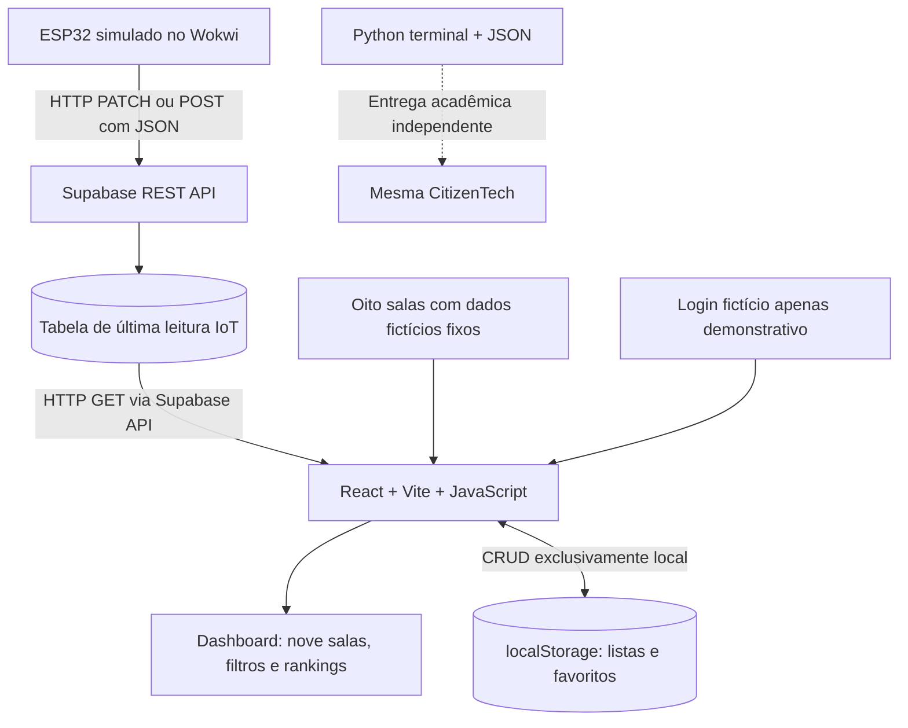

# CONTEXTO DO PROJETO — GLOBAL SOLUTION 2026.2 | CITIZENTECH

> **Documento mestre de contexto para todos os integrantes**  
> Curso: Engenharia de Software — 1º ano — FIAP  
> Versão: **1.0 — especificação inicial consolidada**  
> Data de consolidação: **07/11/2026**  
> Prazo geral do edital: **19/11/2026, às 23h55**  
> Estado: **ideia e decisões de escopo consolidadas; desenvolvimento, testes, pesquisa e entregas ainda não comprovados**.

**Objetivo deste arquivo:** manter os quatro integrantes alinhados sobre **a mesma solução**, evitar interpretações contraditórias e orientar planejamento, implementação, documentação, testes e entregas das **sete disciplinas**. Este é um documento de contexto e especificação — **não** substitui o edital, os enunciados publicados pelos professores nem comprova que algo foi implementado.

## Convenções para interpretar este documento

- **[Obrigatório no PDF]**: exigência do edital oficial; sempre indicar a página.
- **[Decisão do grupo]**: definição estabelecida nas conversas de planejamento.
- **[Sugestão técnica]**: recomendação de implementação, ainda ajustável.
- **[A confirmar]**: assunto que depende de professor, pesquisa, teste técnico ou decisão posterior.
- **[Dado fictício]**: registro inventado explicitamente para demonstração; nunca apresentar como medição real.
- **[Evidência preliminar]**: observação pessoal relatada, ainda sem metodologia ou medição documentada.

**Precedência:** regras acadêmicas do edital > orientações posteriores dos docentes quando fornecidas > decisões do grupo > sugestões deste documento. Uma orientação posterior **relatada verbalmente** deve ser registrada como tal, sem fingir que o texto original do PDF foi alterado.

---

# 1. Ficha CitizenTech — base comum do projeto

> **[Obrigatório no PDF]** Preencher a Ficha CitizenTech e colocá-la no **início do README** do repositório. Edital, **p. 21**. Esta ficha é a versão inicial, e os campos ainda não decididos devem ser completados antes da entrega.

| Campo | Definição atual |
|---|---|
| **Nome da solução** | **[A definir]**. Nome de trabalho: *Monitoramento Inteligente de Salas de Estudo*; nenhuma marca foi definitivamente escolhida. |
| **Cidade e bairro** | São Paulo/SP; campus/bairro específico da FIAP ainda a identificar para a observação. |
| **Cidadão beneficiado** | Estudantes universitários que desejam escolher um ambiente adequado para estudar, trabalhar em grupo ou gravar vídeos/projetos. |
| **Problema em uma frase** | Estudantes têm dificuldade para identificar, antes de se deslocar, salas com espaço e condições adequadas de ruído, temperatura e luminosidade para suas atividades. |
| **Como funciona** | Um ESP32 **simulado** no Wokwi monitora uma sala-modelo; envia as informações ao Supabase via API; uma aplicação React apresenta nove salas (uma com dados transmitidos pela simulação e oito com dados fictícios fixos), aplica filtros e rankings, e permite criar listas e favoritos no navegador. |
| **O que cada parte faz** | **Edge:** leitura/simulação e decisão local; **Supabase:** ponte de dados IoT; **React/Web:** exibição, filtros, rankings e CRUD local de listas; **Python:** simulação independente em terminal; **Matemática:** modelagem de ocupação; **UX:** requisitos e experiência; **Storytelling:** comunicação do valor. |
| **Repositório** | **[Pendente — não inventar link]**. |
| **Indicador de impacto** | **[Proposto]** Redução do tempo para encontrar uma sala adequada; complementarmente, proporção de escolhas bem-sucedidas e satisfação com a recomendação. Ainda **não medidos**. |
| **ODS conectados** | **ODS 4 — Educação de Qualidade** (principal); **ODS 9 — Indústria, Inovação e Infraestrutura** (apoio); possível **ODS 11 — Cidades e Comunidades Sustentáveis** (uso eficiente de espaços coletivos). A relação deve ser explicada, não apenas listada. |

**Fontes de orientação:** edital pp. 7, 11, 14, 18, 21; apresentação de kick-off Wagner, pp. 9 e 31 (pessoas → problemas → tecnologia → inovação → impacto; validar problema, evidências e indicadores).

## 1.1 Equipe

| Integrante | RM | Responsabilidade |
|---|---|---|
| Daniel Roberto | 571746 | **A definir pelo grupo** |
| Felipe Pedrol | 569631 | **A definir pelo grupo** |
| Jecky Cossio | 572226 | **A definir pelo grupo** |
| Felipi Godoy | 573741 | **A definir pelo grupo** |

**[Decisão do grupo]** São **quatro integrantes**, usando este mesmo documento como fonte de verdade. Não atribuir atividades, entregas concluídas ou autoria de código sem acordo. Todos devem conhecer o funcionamento completo. **[Obrigatório no PDF]** A mesma equipe e a mesma CitizenTech atravessam as sete disciplinas (edital, pp. 18, 22, 25).

---

# 2. Problema, contexto e validação

## 2.1 Problemas observados

**FIAP — [Evidência preliminar, relato pessoal]:**

- Há salas que parecem **excessivamente frias**, e para solicitar alteração de ar-condicionado seria preciso procurar um monitor; a pessoa usuária não controla diretamente a temperatura.
- Existem ambientes percebidos como **excessivamente iluminados**, o que pode prejudicar a experiência de estudo de algumas pessoas.
- Em certos ambientes, uma sala pode ter **três mesas e três pessoas, uma em cada mesa**. Há lugares individuais vagos, mas **nenhuma mesa completamente livre** para um grupo trabalhar com privacidade e sem interromper terceiros.
- Não foi feito levantamento padronizado de temperatura, luminosidade, taxas de ocupação ou de ruído. Não tratar observações como números medidos.

**Mackenzie — [Evidência preliminar, relato pessoal]:**

- Foram relatadas salas de estudo **mais cheias e barulhentas**, dificultando encontrar um ambiente adequado.
- O Mackenzie será usado **somente como contexto de pesquisa/possível coleta de evidências**. **Não** será local de instalação, integração ou teste do protótipo.
- Não citar o Mackenzie como instituição parceira, apoiadora ou validante sem autorização e comprovação.

**Local do protótipo:** cenário representativo de **uma sala de estudo da FIAP**, mas **os sensores serão simulados no Wokwi**; não haverá instalação física, nem medição real da sala feita pelo circuito.

## 2.2 O problema central não é apenas “sala cheia”

O valor do produto é responder: **“Qual sala atende melhor à minha atividade e às minhas preferências agora?”**.

O ambiente ideal depende da atividade:

- **Estudo individual:** precisa de pelo menos um lugar; costuma preferir ruído baixo, temperatura e luminosidade confortáveis, mas a preferência é ajustável.
- **Trabalho em grupo:** precisa de **pelo menos uma mesa totalmente vazia**; uma mesa parcialmente ocupada **não** conta como mesa para grupo, mesmo com cadeiras desocupadas. Não haverá escolha da quantidade de participantes do grupo neste MVP.
- **Gravação de vídeo/projeto:** normalmente favorece condições silenciosas, iluminação adequada e espaço disponível, mas estas são **regras sugeridas de ranking**, não requisitos universais das pessoas.

A aplicação **informa e recomenda**; não altera ar-condicionado, lâmpadas, políticas de uso ou reserva assentos.

## 2.3 Pesquisa e evidências que devem ser coletadas

**[A fazer, não inventar resultados]**:

1. Observar ambientes acessíveis da FIAP, registrando **data, local genérico, condições percebidas, ocupação de mesas, limites de privacidade** e número de observações. Se houver medição com instrumento, registrar equipamento/método; caso contrário, identificar como observação qualitativa.
2. Ouvir estudantes da FIAP e, se for possível, do Mackenzie; perguntar sobre dificuldade em encontrar salas, ruído, temperatura, luminosidade e privacidade de grupo.
3. Documentar quantas pessoas participaram, perguntas feitas, respostas autorizadas e principais padrões **somente depois de executar a pesquisa**.
4. Investigar se existem regras institucionais de acesso/uso das salas que afetem as recomendações.
5. Evitar coletar nome, matrícula real, foto ou áudio de colegas. Não gravar pessoas sem autorização.

**Questões orientadoras para entrevistas (sugestão):** “Como você escolhe uma sala hoje?”, “Já perdeu tempo procurando ambiente adequado?”, “O que mais incomoda: lotação, temperatura, luz ou ruído?”, “Você precisa de mesa vazia para atividade em grupo?”, “Você usaria um painel com essas informações?”.

**Critério mínimo de evidência:** relatório breve descrevendo **o que foi observado**, **como**, **quantas observações ocorreram** e **o que ainda é hipótese**. Não se declara benefício alcançado sem avaliação real.

## 2.4 Impacto esperado e indicadores

- **Indicador principal [proposto]:** tempo para escolher/localizar uma sala adequada **antes e depois** de consultar o protótipo em um teste controlado.
- **Indicador secundário [proposto]:** percentual de escolhas em que a sala apresentada atende aos critérios declarados da pessoa usuária.
- **Outros indicadores possíveis:** número de mesas totalmente livres encontradas; avaliação de utilidade e clareza da tela.
- **Limitação:** dados sintéticos e sensores simulados provam o funcionamento lógico, **não comprovam impacto real na universidade**.

---

# 3. Escopo fechado do MVP

## 3.1 Incluído — [Decisão do grupo]

1. **Uma sala IoT-modelo** com **três mesas**, **três lugares por mesa** e **nove lugares sentados**.
2. **Seis botões no Wokwi:** um botão de **entrada** e um de **saída** de pessoas **por mesa**; ocupação total = soma das três mesas.
3. **Nenhuma pessoa em pé** no modelo: toda pessoa contabilizada ocupa um assento. Não contar pessoas em circulação, no corredor ou em pé.
4. Medição/simulação ambiental **por sala**, e **não por mesa**: temperatura, luminosidade e ruído.
5. **Três faixas de leitura** para cada indicador e **três estados operacionais de alerta** do dispositivo (verde, amarelo e vermelho), com comportamento de falha definido.
6. Envio **real pela rede do simulador** do ESP32 para a **API do Supabase**, e consulta desses valores pela interface React. “Real” aqui significa **integração funcionando**, não medição física real.
7. **Nove salas no dashboard:** uma abastecida pelo Wokwi e **oito fictícias com dados fixos**.
8. Todos os cartões de sala mostram **informações diretamente na listagem**; o usuário **não precisa clicar para ver os dados principais**.
9. Filtros manuais por ocupação da sala, ocupação/estado das mesas, ruído, temperatura e luminosidade, inclusive **intervalos**.
10. Atalhos de recomendação **Estudar sozinho**, **Trabalho em grupo** e **Gravar vídeo/projeto**, que aplicam filtros/pesos e exibem ranking de salas; filtros permanecem ajustáveis.
11. **Favoritar salas** e **criar, listar, renomear/editar e excluir listas**, incluindo adicionar e remover salas.
12. **Todo o CRUD de listas e favoritos será local via `localStorage`**, com dados independentes **por navegador/perfil**.
13. **Uma matrícula e senha fictícias e fixas** para entrar na demonstração, **sem cadastro de usuários**; login é apenas demonstrativo, sem autenticação institucional nem necessidade de contas Supabase Auth.
14. Mostrar a **última leitura conhecida**, seu horário e um aviso quando estiver **desatualizada**; não fingir atualização permanente.
15. Front-end React + **JavaScript** + Vite + Tailwind; **não** utilizar TypeScript por necessidade deste MVP.
16. Programa Python independente em terminal, modelagem matemática, slides UX, videopitch e demais artefatos **coerentes com a mesma ideia**.

## 3.2 Explicitamente fora do escopo

- Instalar sensores físicos na FIAP ou no Mackenzie.
- Visão computacional, câmeras, microfones reais e reconhecimento de pessoas.
- Contagem de pessoas em pé ou por sensor automático de presença neste MVP.
- Reservar mesas, impedir entrada física, controlar ar-condicionado, luminárias ou qualquer equipamento da faculdade.
- Painel administrativo, criação/edição/exclusão de salas por administradores, gestão de funcionários.
- Comentários, relatos de problemas, avaliações públicas e notificações push.
- Contas individuais, cadastro de estudantes, recuperação de senha, login real da FIAP, integração com diretório institucional.
- Armazenar listas e favoritos no Supabase; **o Supabase armazena apenas a telemetria da sala IoT-modelo** (e, se necessário, metadados técnicos mínimos dessa sala).
- Recomendações por inteligência artificial, aprendizado de máquina e previsão de lotação.
- Garantia de precisão real de temperatura, lux ou dB sem hardware/calibração física.

## 3.3 Discrepância resolvida com a orientação docente relatada

**Importante — não apagar este registro:**

- **[Obrigatório no PDF]** Front-end Design e Web Development descrevem **“consumir API externa com operações completas de CRUD”** (edital **pp. 40 e 59**) e, na lista de entregáveis, **“consumir uma API externa e implementar operações de CRUD”** (edital **pp. 42 e 61**).
- **[Orientação posterior relatada pelo integrante do grupo]**: segundo consulta aos professores, **o consumo de uma API externa e o CRUD funcional podem ser demonstrados separadamente**, sem exigir que o CRUD seja realizado na API. Esta é a orientação que o grupo decidiu seguir.
- **[Decisão final do grupo]**: consumir **Supabase para dados IoT** e fazer CRUD **100% no `localStorage`** para listas e favoritos.
- **[Registro recomendado]**: guardar mensagem/print/resposta escrita ou o nome e contexto do esclarecimento docente caso a correção questione a interpretação. **Não afirmar que o PDF explicitamente autoriza CRUD local**, pois a redação é ambígua.
- Não criar uma funcionalidade de comentários/relatos só para fabricar outro CRUD. A última decisão **substitui** propostas anteriores de CRUD de listas pelo Supabase.

---

# 4. Salas, mesas e ocupação

## 4.1 Distribuição das nove salas

| Tipo de sala | Quantidade de salas | Mesas por sala | Lugares por mesa | Lotação sentada por sala | Lugares somados |
|---|---:|---:|---:|---:|---:|
| Pequena | 2 | 2 | 3 | 6 | 12 |
| Média | 5 | 3 | 3 | 9 | 45 |
| Grande | 2 | 4 | 3 | 12 | 24 |
| **TOTAL** | **9** | **27 mesas no total** | — | — | **81 lugares** |

**Apenas uma das cinco salas médias** será conectada ao Wokwi. As demais **oito salas são fictícias e estáticas**. Os números acima são parâmetros **do protótipo**, não inventário medido da FIAP ou do Mackenzie.

### Identificadores propostos (ajustáveis)

| ID | Nome ilustrativo | Mesas | Capacidade | Fonte |
|---|---|---:|---:|---|
| S01 | Sala de Estudo 01 | 3 | 9 | **ESP32/Wokwi → Supabase** |
| S02 | Sala de Estudo 02 | 2 | 6 | Dados fictícios fixos |
| S03 | Sala de Estudo 03 | 2 | 6 | Dados fictícios fixos |
| S04 | Sala de Estudo 04 | 3 | 9 | Dados fictícios fixos |
| S05 | Sala de Estudo 05 | 3 | 9 | Dados fictícios fixos |
| S06 | Sala de Estudo 06 | 3 | 9 | Dados fictícios fixos |
| S07 | Sala de Estudo 07 | 3 | 9 | Dados fictícios fixos |
| S08 | Sala de Estudo 08 | 4 | 12 | Dados fictícios fixos |
| S09 | Sala de Estudo 09 | 4 | 12 | Dados fictícios fixos |

**[Sugestão técnica]** Os oito ambientes estáticos podem vir de um arquivo JavaScript/JSON versionado em `src/data/salasDemo.js`, sem armazená-los em banco. A sala S01 recebe seu estado atual da API. Os nomes são **fictícios**: não identificar esses registros como salas oficiais reais de instituições.

## 4.2 Regras de contagem

Seja `ocupacaoMesa[i]` a quantidade de pessoas sentadas na mesa `i`, com `0 ≤ ocupacaoMesa[i] ≤ 3`.

- `ocupacaoSala = soma(ocupacaoMesa)`.
- `capacidadeSala = quantidadeMesas * 3`.
- `vagasIndividuais = capacidadeSala - ocupacaoSala`.
- `mesasTotalmenteVazias = contagem de mesas com ocupacaoMesa == 0`.
- `taxaOcupacao = 100 * ocupacaoSala / capacidadeSala` (capacidade > 0).
- **A cada botão de entrada:** adicionar uma pessoa somente se a mesa tiver menos de três.
- **A cada botão de saída:** retirar uma pessoa somente se a mesa tiver pelo menos uma.
- Para o atalho de grupo, **mesa parcialmente ocupada não é disponível**; o atalho prioriza ambientes com ao menos uma mesa totalmente vazia.
- A ausência de pessoas em pé é uma **hipótese de simplificação**, não uma afirmação sobre ambientes reais.

**Exemplo:** ocupações `[1, 1, 1]` → total 3, 6 cadeiras individuais livres, **zero** mesas integralmente vazias. Portanto: pode atender estudo individual, mas **não** é uma boa indicação para o atalho de grupo.

---

# 5. Circuito Edge / Wokwi

## 5.1 Componentes planejados

| Componente | Qtde. | Uso no protótipo | O que realmente representa |
|---|---:|---|---|
| ESP32 | 1 | Lógica local e comunicação Wi-Fi | Microcontrolador simulado |
| Botões de pressão | 6 | `+1` e `-1` em cada mesa | **Eventos manuais simulados**, não sensor automático de ocupação |
| DHT22 | 1 | Temperatura da sala; umidade se desejada | Leitura **simulada** do sensor |
| LDR/fotorresistor | 1 | Indicador de luminosidade da sala | Leitura virtual, sujeita a conversão aproximada |
| Potenciômetro | 1 | Controlar **dB fictícios** | **Não** é microfone nem medidor real de decibéis |
| LEDs verde, amarelo e vermelho | 1 de cada | Alerta local geral | Atuadores simulados |
| Resistores, fios e alimentação | Conforme circuito | Ligações corretas | Componentes auxiliares |

**[Sugestão técnica]** Usar **ESP32 programado em C++ com o framework Arduino** diretamente no Wokwi; não há necessidade de uma segunda placa Arduino Uno ou de intermediário Google Colab. O projeto pode usar outras alternativas se comprovadamente mais simples, mas deverá preservar a lógica exigida na rubrica.

Fontes técnicas: [Wokwi — ESP32 Wi-Fi](https://docs.wokwi.com/guides/esp32-wifi), [DHT22](https://docs.wokwi.com/parts/wokwi-dht22), [Potenciômetro](https://docs.wokwi.com/parts/wokwi-potentiometer), [Botão](https://docs.wokwi.com/parts/wokwi-pushbutton).

## 5.2 Três dimensões diferentes — não confundir

1. **Valor numérico:** ex.: 18 °C, 55 dB **simulados**, valor aproximado de luminosidade e 7 pessoas.
2. **Faixa da grandeza (baixo / médio / alto):** indica onde o valor está na escala; **não** diz automaticamente se é bom ou ruim.
3. **Severidade de conforto/uso (adequado / atenção / crítico):** depende das necessidades e dos limites. Ex.: **temperatura muito baixa também pode ser crítica**; luz excessivamente baixa ou alta também pode ser ruim.

**[Decisão do grupo]** Classificar **temperatura, luminosidade, ruído e ocupação**; cada métrica tem faixas, e o circuito sintetiza um estado geral.

### Lógica dos LEDs — [Decisão do grupo, com correção de interpretação]

- **Vermelho:** **pelo menos um** dos indicadores está **crítico**.
- **Amarelo:** **nenhum** está crítico, mas **pelo menos um** exige atenção/moderação.
- **Verde:** **todos** estão adequados.
- **Falha de sensor/conexão:** comportamento de erro distinto e documentado (ex.: vermelho piscando + mensagem no Serial Monitor); não mostrar verde por falta de leitura.

**Importante:** não confundir “baixo” com “bom” em todas as variáveis. Uma sala fria ou escura demais **não** deve sinalizar automaticamente verde.

### Limites numéricos — [A definir, NÃO inventar padrões]

É necessário documentar uma tabela **única de critérios**, compartilhada conceitualmente entre Edge, React, Python, Matemática e slides:

| Indicador | Baixo / médio / alto | Adequado / atenção / crítico | Status da decisão |
|---|---|---|---|
| Temperatura (°C) | Faixas quantitativas a estabelecer | Temperaturas muito baixas **ou** muito altas podem alertar | **Pendente de limite numérico e justificativa** |
| Luminosidade (unidade/índice declarado) | Faixas a estabelecer | Pouca **ou** muita luz pode alertar | **Pendente de escala e limite** |
| Ruído (dB **simulados**) | Silencioso / moderado / barulhento | Ruído maior tende a gerar mais alerta; considerar atividade | **Pendente de limite e fórmula** |
| Ocupação (%) | Baixa / média / alta | Ocupação elevada tende a gerar alerta; distinguir ocupação de sala e mesas vazias | **Pendente de limite e fórmula** |

**[Sugestão]** Guardar os limites em uma tabela de especificação/arquivo de configuração. Quando forem definidos, transcrevê-los para C++ e JavaScript e **testar a equivalência**, pois são ambientes de execução diferentes.

## 5.3 Ruído simulado em decibéis: honestidade técnica

**[Decisão do grupo]** Mostrar um número em **dB simulados**, uma classificação qualitativa e um **índice de ruído de 0 a 100** no dashboard.

O potenciômetro gera uma grandeza analógica. Um algoritmo definido pelo grupo poderá **mapear** esse sinal para, por exemplo, um intervalo fictício de decibéis. Isso **não é medição de pressão sonora**, não equivale a `dB(A)` calibrado e não deve ser apresentado como tal. A escala de decibéis é logarítmica; não equiparar “55 dB = 55 pontos”.

**[Sugestão de normalização didática, A VALIDAR]** Se o grupo adotar um intervalo ilustrativo `DB_MIN` a `DB_MAX`, usar:

```text
indiceRuido = arredondar(100 * (dbSimulado - DB_MIN) / (DB_MAX - DB_MIN))
indiceRuido = limitar(indiceRuido, 0, 100)
```

- `0` = extremo inferior da escala **escolhida pelo grupo**; `100` = extremo superior.
- A pontuação pode representar **intensidade do ruído** (100 = mais ruidoso), não “qualidade de estudo”. Se houver pontuação de qualidade, usar **outro nome** e orientação explícita (100 = mais adequado).
- Exibir selo **“dado simulado”**; os limiares de silêncio/moderação/barulho precisam de justificativa. O valor numérico não é uma medida de saúde ocupacional ou conforto certificada.

## 5.4 Luminosidade e temperatura

- **Temperatura:** usar leitura do DHT22 virtual. Umidade relativa é um valor disponível no DHT22, mas **não é funcionalidade obrigatória do MVP**; só adicionar à interface se não desviar foco.
- **Luminosidade:** informar claramente se a aplicação mostra **lux aproximado** ou **índice adimensional**. Não afirmar exatidão fotométrica sem calibração. Mostrar faixas baixa/média/alta e condições excessivamente escuras/claras como alertas.
- **Erros:** leitura numérica fora da faixa prevista, NaN/sem leitura e dados antigos exigem tratamento explícito.

## 5.5 Critérios técnicos que Edge exige

**[Obrigatório no PDF — pp. 36–38]**:

- Dispositivo com lógica própria: **medir → decidir → alertar/atuar**; estados localmente observáveis.
- **Pelo menos três estados**, respostas distintas, limites justificados, **suavização** e tratamento de leitura inválida.
- **Funções, constantes, `millis()`, comentários e saída no Serial Monitor**.
- Arquitetura IoT em camadas: dispositivo, serviço de dados, dashboard; comportamento local continua significativo se não houver rede.
- Diagrama organizado; projeto Wokwi compartilhável e funcionando sem ajustes; vídeo **até 7 minutos**, narrado, demonstrando estados, circuito, decisões e alterações das entradas.

**[Sugestão de implementação]**:

- Botões com detecção de borda e **debounce**; impedir cliques contínuos por um único pressionamento.
- Loop principal sem `delay()` bloqueante para tarefas periódicas; usar `millis()` para ler, suavizar, classificar e publicar.
- Média móvel para ruído/luminosidade/temperatura quando apropriado; usar também **histerese** perto dos limiares para evitar LEDs piscando repetidamente.
- Mensagens no Serial Monitor com leituras individuais, ocupação de cada mesa, estado global, tentativa de envio, sucesso/erro HTTP e horário aproximado.
- Reações locais seguem funcionando quando o Supabase ou Wi-Fi estiver indisponível; reenviar depois, se possível, sem comprometer a simulação.

**[A confirmar com professor de Edge]** O edital nomeia “back-end FIWARE ou IoT Cloud” na arquitetura da **p. 36**. Confirmar que **Supabase**, como serviço de dados em nuvem, é aceito nessa camada. Não afirmar aceitação sem evidência docente.

---

# 6. Arquitetura de integração — Wokwi, Supabase e React

## 6.1 Diagrama conceitual



**[Decisão final]** O Supabase **não** terá contas de estudantes, listas personalizadas ou favoritos. Sua função será transportar/armazenar os dados da **sala monitorada pelo Wokwi**, para que o React os consulte pela API. **Não há necessidade de Google Colab nem de backend Python/Node próprio** nesta arquitetura.

## 6.2 Fluxo previsto, ponta a ponta

1. Uma pessoa pressiona `+` da Mesa 2 no Wokwi ou altera temperatura/luz/ruído virtual.
2. O ESP32 valida a entrada, atualiza o estado interno, calcula as faixas e o LED geral.
3. Em intervalo controlado, o ESP32 usa Wi-Fi virtual do Wokwi e **envia a última leitura** ao Supabase via HTTP(S), em JSON.
4. O Supabase atualiza o registro da sala principal (ou armazena a nova leitura, se o grupo optar por histórico).
5. O React faz `GET` periódico (ex.: intervalo de poucos segundos **a testar**) e atualiza o cartão S01 **sem recarregar a página**.
6. A tela combina S01 com S02–S09, guardadas como dados fictícios estáticos, e recalcula filtros e rankings.
7. Favoritos e listas são gravados e lidos do `localStorage` de **cada navegador**, sem tráfego com o Supabase.

**[Critério de prova da integração]** Alterar uma entrada no Wokwi, observar publicação sem erro, conferir valor novo na API e verificar que o cartão do React muda para o mesmo valor. **Nenhum desses testes foi executado ainda.**

## 6.3 API / modelo mínimo de telemetria (proposta)

**[Sugestão]** Uma tabela `room_telemetry` com **um registro atual para S01** evita complexidade de histórico. A operação do ESP32 pode ser atualização (`PATCH`) de linha previamente criada; o React executa apenas leitura (`GET`). Se preferirem armazenar histórico, isso será decisão posterior e não é necessário para o MVP.

| Campo | Tipo sugerido | Significado |
|---|---|---|
| `room_id` | `text`, chave primária | `S01` |
| `occupancy_by_table` | `jsonb` | Array `[0..3, 0..3, 0..3]` |
| `temperature_c` | `numeric` | Temperatura do DHT22 virtual |
| `light_value` | `numeric` | Lux aproximado ou índice, conforme especificação |
| `light_unit` | `text` | `lux_estimado` ou `indice` |
| `noise_db_simulated` | `numeric` | dB gerados artificialmente a partir da entrada do potenciômetro |
| `device_status` | `text` | `ok`, `sensor_error`, `offline` etc. |
| `updated_at` | `timestamptz` | Instante da última **recepção no banco**, preferencialmente atribuído pelo servidor |

**Exemplo de payload — [Dado fictício]**:

```json
{
  "room_id": "S01",
  "occupancy_by_table": [1, 2, 0],
  "temperature_c": 22.8,
  "light_value": 410,
  "light_unit": "lux_estimado",
  "noise_db_simulated": 54,
  "device_status": "ok"
}
```

No exemplo, `ocupacaoTotal = 3`, `lugaresVagos = 6`, `mesasVazias = 1`. A soma é calculada/validada, não enviada como fonte independente de verdade. Valores são **apenas ilustrativos**.

**[Sugestão]** Manter os metadados das nove salas e as leituras estáticas em arquivos do frontend (`src/data/salasDemo.js`). No React, combinar a lista local de salas com **a única leitura de S01** vinda da API. Não confundir “frontend com dados estáticos” com “frontend estático”: a aplicação terá lógica, filtros, rankings e CRUD local funcionais.

## 6.4 Segurança e limites assumidos

- **[Decisão do grupo]** Prioridade é demonstração simples com dados fictícios; **não** se pretende segurança de produção.
- A matrícula e a senha serão **fictícias** e únicas; a verificação em JavaScript no navegador constitui **login demonstrativo visual**, não controle de acesso seguro. Não dizer que a plataforma está integrada à autenticação da FIAP.
- **Sem cadastro** e **sem contas de estudantes no Supabase Auth**.
- Nunca incorporar **chaves `service_role` / secret / administrativas** no código React, no repositório ou em projeto Wokwi público. Usar chave **publicável** e permissões restritas à tabela de telemetria simulada. Controle insuficiente poderá permitir alteração dos dados de demonstração; documentar isso.
- Dados de pesquisa não devem incluir informações pessoais sensíveis. O Wokwi usa gateway de rede: não transmitir dados privados reais.
- **[A testar]** Configuração do Supabase (RLS, permissões da tabela e cabeçalhos de API), disponibilidade do gateway do Wokwi, limites do plano, eventuais falhas de comunicação e atualização visual.

Referências externas de implementação: [Wokwi — ESP32 Wi-Fi](https://docs.wokwi.com/guides/esp32-wifi), [Supabase — Data REST API](https://supabase.com/docs/guides/api), [Supabase — criação de rotas/API keys](https://supabase.com/docs/guides/api/creating-routes). Estas fontes explicam possibilidades técnicas, **não** comprovam que a integração da equipe já funciona.

## 6.5 Dados desatualizados

**[Decisão do grupo]** Quando o Wokwi parar de enviar dados, o usuário verá a **última leitura**, com horário e aviso de desatualização.

**[Sugestão]** Exibir `Atualizado às HH:MM` e sinal **“Dados desatualizados — última leitura recebida”** após um intervalo `STALE_AFTER_SECONDS` configurável (valor **a definir/testar**). Nunca marcar a sala como “monitorada ao vivo” se a leitura está antiga. As oito salas estáticas devem trazer selo **“Dados demonstrativos”** permanentemente.

---

# 7. Aplicação web: telas, funcionalidades e experiência

## 7.1 Stack decidida

- React com **Vite** e **JavaScript/JSX**; **sem TypeScript** como obrigação.
- Tailwind CSS para estilização.
- `useState`, `useEffect`, **no mínimo dois hooks personalizados**; mínimo de oito componentes React reutilizáveis.
- Separar componentes visuais, regras e acesso aos dados (API e `localStorage`).
- Supabase acessado para consultar a sala S01; **nenhum CRUD remoto de listas**.
- Deploy acessível para avaliação, por exemplo na Vercel (link ainda **não criado**).
- GitHub privado com pelo menos quinze commits significativos e concessão de acesso aos professores conforme edital.

**[Obrigatório no PDF]** Requisitos do frontend, web, ZIP, README, `AI.md`, links, deploy e commits: **pp. 40–42 e 59–61**.

## 7.2 Fluxo principal do estudante

1. Acessa o endereço do protótipo.
2. Informa **matrícula e senha fictícias únicas**. Não existe cadastro.
3. Entra em uma **única página principal** com cards de **todas as nove salas**, podendo rolar para baixo.
4. Cada card exibe capacidade, ocupação total, pessoas em cada mesa, quantidade de mesas totalmente vazias, temperatura, luminosidade, ruído, status e origem/atualização dos dados.
5. Escolhe um atalho (`Estudar sozinho`, `Trabalho em grupo`, `Gravar vídeo/projeto`) ou define filtros manuais por faixas numéricas.
6. Visualiza um **ranking** de salas adequadas ao objetivo; pode ajustar filtros sem perder a visibilidade dos cartões.
7. Marca salas como favoritas ou cria uma lista personalizada; adiciona/retira salas; edita nome e exclui listas.
8. As listas persistem **somente no perfil daquele navegador**, inclusive após fechar e reabrir, enquanto o armazenamento local for preservado.

**Não há tela de detalhe obrigatória**, nem painel administrativo.

## 7.3 Proposta de telas mínimas

| Tela/área | Conteúdo | Observação |
|---|---|---|
| Entrada demonstrativa | Campos fictícios de matrícula/senha, erro de preenchimento | Não prometer segurança real |
| Dashboard único | Nove cards de salas com todas as métricas | Rolagem vertical; responsivo |
| Barra de filtros/ranking | Intervalos de temperatura, luminosidade, ruído, ocupação e atalho de atividade | Filtros podem ser removidos/limpos |
| Favoritos | Indicadores de sala favoritada; visualização de favoritas | Salvo localmente |
| Minhas listas | Criar, ver, renomear, excluir, adicionar/remover salas | CRUD local completo |
| Estado de dados | Atualização, `IoT simulado`, `Demo estática`, `Desatualizado`, `Erro` | Não ocultar origem |

## 7.4 Filtros — comportamento esperado

**[Decisão do grupo]** Permitir, no mínimo:

- Ocupação **total da sala** por valor exato (ex.: `3`) ou intervalo **inclusivo** (ex.: entre `3` e `6`).
- Ocupação **por mesa** / existência de mesas livres (ex.: ao menos uma mesa com `0/3`).
- Temperatura por faixa ou intervalo selecionado.
- Luminosidade por faixa ou intervalo selecionado.
- Ruído por faixa ou intervalo selecionado.

**[Sugestão técnica]** Representar filtros em estado React e aplicar sobre os **nove registros normalizados**. Mostrar contador de resultados, estado vazio explicativo e botão **“Limpar filtros”**. Não exigir seleção da quantidade de pessoas no grupo.

## 7.5 Atalhos e ranking — regra de negócio proposta

**[Decisão do grupo]** Os três atalhos devem oferecer ordenação dinâmica baseada em critérios definidos, e o estudante ainda pode mudar os filtros. **Não** são rankings fixos nem recomendações de IA.

| Atalho | Elegibilidade / prioridade sugerida | Observações |
|---|---|---|
| **Estudar sozinho** | Preferir salas com ao menos um assento livre; favorecer silêncio e condições ambientais adequadas | Mesa parcialmente ocupada pode servir para estudo individual |
| **Trabalho em grupo** | **Exigir ao menos uma mesa completamente vazia**; priorizar **menor ocupação da sala** e maior número de mesas vazias | **Sem campo de tamanho do grupo**; mesa ocupada por um desconhecido não é elegível como mesa de grupo |
| **Gravar vídeo/projeto** | Preferir ruído baixo, iluminação adequada e espaço disponível | Preferências são hipótese inicial ajustável; não garantir autorização institucional para gravar |

**[A definir]** Pesos exatos da pontuação 0–100 por atalho, desempates e limites de conforto. O grupo deve validar a coerência antes de apresentar percentuais como se fossem cientificamente calibrados.

**[Sugestão de desenho do algoritmo]** Primeiro aplicar condições eliminatórias (quando houver), depois calcular score **determinístico** por distância às faixas de preferência, e ordenar do maior para o menor. Se a sala IoT estiver desatualizada, mostrar aviso e definir se ela continuará ranqueável; não tratá-la como medição atual.

## 7.6 Dados fictícios das outras oito salas — exemplos de seed

**Não são medições reais.** Estes exemplos são opcionais, para testar filtros e rankings; podem ser alterados mantendo a distribuição de capacidades.

| Sala | Ocupação por mesa (exemplo) | Total | Mesa vazia? | Temperatura fictícia | Luz fictícia (lux estimado) | Ruído fictício (dB sim.) |
|---|---|---:|---|---:|---:|---:|
| S02 | `[0, 2]` | 2 | Sim | 22 °C | 410 | 42 |
| S03 | `[3, 3]` | 6 | Não | 18 °C | 920 | 71 |
| S04 | `[1, 1, 1]` | 3 | Não | 21 °C | 500 | 46 |
| S05 | `[0, 3, 3]` | 6 | Sim | 24 °C | 350 | 57 |
| S06 | `[2, 2, 1]` | 5 | Não | 19 °C | 180 | 61 |
| S07 | `[0, 0, 1]` | 1 | Sim | 23 °C | 450 | 39 |
| S08 | `[3, 2, 1, 0]` | 6 | Sim | 25 °C | 600 | 53 |
| S09 | `[3, 3, 3, 2]` | 11 | Não | 28 °C | 760 | 68 |

**S01 não tem valores estáticos de produção:** deriva da **última leitura** enviada pelo Wokwi/Supabase. Para modo de pré-visualização offline, eventual fallback deverá ser explicitamente rotulado como **demonstração**, não como leitura atual.

## 7.7 Listas e favoritos — CRUD **somente no localStorage**

**[Decisão final, sobrescreve todas as propostas anteriores]**:

- Criar lista personalizada.
- Listar/consultar listas existentes.
- Renomear uma lista e, opcionalmente, editar sua descrição.
- Excluir uma lista.
- Adicionar uma ou mais salas a uma lista.
- Remover uma sala de uma lista.
- Favoritar/desfavoritar salas.
- Persistir tudo **somente no navegador que realizou a ação**.
- **Não** enviar listas, favoritos, identificadores de usuário ou perfis ao Supabase.

**Exemplo de dados locais:**

```json
{
  "schema_version": 1,
  "favorites": ["S01", "S07"],
  "lists": [
    {
      "id": "local-uuid-da-lista",
      "name": "Para trabalho em grupo",
      "room_ids": ["S02", "S07", "S08"]
    }
  ]
}
```

**[Sugestão técnica]** Chave `citizentech_user_preferences_v1`; usar `JSON.stringify` e `JSON.parse` com tratamento de dados ausentes/corrompidos; validar nomes vazios, IDs duplicados, salas inexistentes e exclusão confirmada. Para cada novo registro, gerar UUID local; **não** construir cadastro de usuários para resolver isolamento. O mesmo computador **no mesmo perfil de navegador** compartilhará listas; computadores/perfis diferentes terão estados separados. Limpar armazenamento apagará listas locais.

**Atenção à rubrica:** o grupo relatou esclarecimento docente permitindo CRUD local + API externa separada. Manter evidência da orientação, porque a redação literal das pp. 40, 42, 59 e 61 é diferente da interpretação adotada.

## 7.8 Tom de voz e acessibilidade

**[Sugestão]** Linguagem simples, objetiva e não alarmista:

- “2 mesas totalmente livres” (em vez de apenas “há vagas”).
- “Sala adequada para estudo em grupo” (com base nos critérios configurados).
- “Ruído alto — valor simulado” (sem sugerir medição certificada).
- “Última atualização às 14:32; simulação interrompida” (em vez de parecer tempo real).

Acessibilidade: contraste, leitura por teclado, rótulos de campos, unidades de medida explícitas, estados **não dependentes só da cor**, mensagens de erro compreensíveis, cards responsivos e textos alternativos quando necessário.

### Sugestão de componentes/hook mínimos

- **Componentes (≥8):** `LoginForm`, `DashboardHeader`, `RoomCard`, `RoomOccupancy`, `EnvironmentalMetric`, `FilterPanel`, `ActivityPresets`, `RoomRanking`, `FavoriteButton`, `ListManager`, `DataFreshnessBadge` (subconjunto suficiente, de fato reutilizável).
- **Hooks personalizados (≥2):** `useRoomReadings()` (API, atualização, loading/erro) e `useLocalCollections()` (listas/favoritos CRUD local); `useRoomFilters()` é opcional.
- **Camadas:** `components/` apresentação; `hooks/` estado; `services/supabase.js` API; `services/localCollections.js` persistência; `domain/` regras e classificações; `data/` salas fictícias.

---

# 8. Requisitos funcionais, não funcionais e regras de negócio

> **[Obrigatório no PDF]** Software & Total Experience exige descrição, **classificação e justificativa** de RF, RNF e regras de negócio; o diagrama de casos de uso e o protótipo devem ser coerentes (edital pp. 45–47). Os itens abaixo são **primeira proposta de especificação**, revisável com o grupo.

## 8.1 Requisitos funcionais (RF)

| ID | O sistema deve… | Por quê? | Critério de aceite resumido |
|---|---|---|---|
| RF-01 | Exibir login demonstrativo único | Delimitar a experiência proposta | Credenciais fictícias corretas liberam tela; incorretas mostram erro |
| RF-02 | Listar nove salas na mesma tela | Evitar abrir páginas individuais | Nove cards aparecem com rolagem, sem tela obrigatória de detalhe |
| RF-03 | Mostrar ocupação total e por mesa | Diferenciar cadeiras livres de mesas vazias | `[1,1,1]` mostra 3 ocupados e 0 mesas vazias |
| RF-04 | Mostrar temperatura, luminosidade e ruído por sala | Permitir avaliar condições ambientais | Cada card traz unidade/índice, valor e classe |
| RF-05 | Atualizar S01 a partir do Supabase | Demonstrar integração Wokwi–API–Web | Mudança validada no Wokwi aparece no React sem reload manual |
| RF-06 | Identificar origem e frescor dos dados | Evitar confusão sobre leituras simuladas | S01 mostra atualização; S02–S09 mostram “Dados demonstrativos” |
| RF-07 | Filtrar salas por valores/faixas | Atender preferências | Ocupação exata ou intervalo retorna apenas salas compatíveis |
| RF-08 | Aplicar atalhos e ranking por atividade | Facilitar escolha | Sozinho, grupo e vídeo apresentam ordenações coerentes e ajustáveis |
| RF-09 | Permitir favoritar/desfavoritar salas | Acesso rápido | Favoritos persistem no navegador após recarregar |
| RF-10 | Criar e listar listas pessoais locais | Organizar salas | Nova lista aparece e permanece no `localStorage` |
| RF-11 | Editar e excluir listas locais | Cumprir ciclo CRUD local | Renomeação e exclusão mudam estado e persistem após reload |
| RF-12 | Adicionar e remover salas de listas | Usar listas de verdade | Lista reflete mudanças sem duplicações indevidas |
| RF-13 | Tratar ausência/falha de dados | Não induzir uso errado | Mostra erro/estado antigo sem inventar medição |
| RF-14 | Permitir limpar/ajustar filtros | Evitar estado sem saída | Limpar restaura todas as nove salas |

## 8.2 Requisitos não funcionais (RNF)

| ID | Qualidade/condição | Justificativa | Evidência/critério de aceite sugerido |
|---|---|---|---|
| RNF-01 | Aplicação responsiva | Uso no celular ao procurar sala | Testar viewport móvel e desktop sem cortes |
| RNF-02 | Acessibilidade básica | Informações devem ser compreensíveis | Teclado, foco visível, rótulos e status além de cores |
| RNF-03 | Persistência local | Listas de cada navegador não se confundem | Fechar/abrir preserva; outro perfil não vê listas |
| RNF-04 | Clareza sobre simulação | Evitar falsa promessa de medição real | Origem e unidades declaradas em tela e README |
| RNF-05 | Tratamento de erros | API/Wi-Fi podem falhar | Erros exibidos sem quebrar a aplicação |
| RNF-06 | Separação de responsabilidades | Facilitar manutenção e nota de código | API, domínio, armazenamento e UI em arquivos/módulos distintos |
| RNF-07 | Atualização sem reload manual | Experiência de acompanhamento | Alterar Wokwi; interface reflete a nova leitura após polling configurado |
| RNF-08 | Dados consistentes | Ranking não pode usar ocupação impossível | Nenhuma mesa <0 ou >3; somas coerentes |
| RNF-09 | Interface simples | Público estudante sem treinamento | Informações essenciais visíveis no card; filtros legíveis |
| RNF-10 | Documentação e execução reproduzível | Professores precisam avaliar | README, passos, dependências, API e limitações claras |

**[A definir]** Metas quantitativas de desempenho e intervalo de atualização devem ser escolhidas **após teste**, não anunciadas como já cumpridas.

## 8.3 Regras de negócio (RN)

| ID | Regra | Justificativa / verificação |
|---|---|---|
| RN-01 | Toda mesa tem exatamente 3 assentos no modelo | Capacidade definida pelo grupo; tentativas acima de 3 são rejeitadas |
| RN-02 | Capacidade sentada = 3 × número de mesas | Pequena=6; média=9; grande=12 |
| RN-03 | Ocupação total = soma das mesas | Não usar contador independente divergente |
| RN-04 | Pessoas em pé = 0 neste MVP | Simplificação assumida e divulgada |
| RN-05 | Botão `+` não excede 3, e botão `-` não reduz abaixo de 0 | Evita contagem impossível |
| RN-06 | Para trabalho em grupo só conta mesa com ocupação `0` | Privacidade e não compartilhar mesa com desconhecidos |
| RN-07 | Não há campo para número de integrantes do grupo | Escopo simplificado por decisão do grupo |
| RN-08 | Red se qualquer métrica for crítica; yellow se nenhuma crítica e alguma em atenção; green somente se todas adequadas | Resposta local dos LEDs; separar faixa de leitura e severidade |
| RN-09 | Temperatura/luz excessivamente baixas também podem ser inadequadas | “Baixo” não implica “bom” |
| RN-10 | Oito salas são estáticas e fictícias; uma usa Supabase | Transparência da origem da informação |
| RN-11 | Leituras antigas mantêm último valor com aviso | Não simular disponibilidade em tempo real inexistente |
| RN-12 | CRUD de listas e favoritos é estritamente local | Orientação docente relatada e decisão final do grupo |
| RN-13 | Mesmas credenciais fictícias demonstrativas, sem cadastro | Não criar autenticação institucional ou usuários no banco |
| RN-14 | Filtros trabalham com valores numéricos e intervalos inclusivos | Comportamento testável e previsível |
| RN-15 | Rankings são determinísticos, explicáveis e editáveis por filtros | Sem IA e sem pontuações arbitrárias escondidas |

## 8.4 Casos de uso e atores sugeridos

**Atores:**

- **Estudante (usuário demonstrativo):** entrar, ver salas, filtrar, usar atalhos, favoritar, gerir listas.
- **Dispositivo ESP32 simulado (ator externo ao software web):** transmitir leitura.
- **Supabase (sistema externo):** disponibilizar última leitura IoT à interface.

**Não adicionar ator “administrador”** porque não haverá painel administrativo.

**Casos de uso principais:** `UC-01 Entrar`, `UC-02 Consultar salas`, `UC-03 Filtrar salas`, `UC-04 Ver recomendações`, `UC-05 Favoritar sala`, `UC-06 Criar lista`, `UC-07 Consultar lista`, `UC-08 Editar lista`, `UC-09 Excluir lista`, `UC-10 Adicionar/remover sala de lista`; `UC-11 Receber/consultar telemetria` como interação entre sistemas. Elaborar diagrama UML legível e contextualizar objetivos, relações e atores conforme **edital p. 46**.

---

# 9. Como integrar as sete disciplinas sem criar sete produtos diferentes

## 9.1 Computational Thinking with Python — aplicação de terminal

**[Obrigatório no PDF: pp. 29–32]** Criar **uma aplicação Python** alinhada à CitizenTech, com:

- Menu com funcionalidades; entradas validadas; `try/except`; decisões com `if/elif/else` **e** `match/case`; laços `while` **e** `for`; funções com parâmetros e retorno; **listas, tuplas e dicionários**; leitura/gravação em **JSON**; boas práticas.
- Código `.py`, README e documentação do uso real de IA, entregues em **ZIP** na tarefa de Python.
- O texto da **p. 31** exige **`prompts.md`**, enquanto a **p. 32** lista **`prompt.md`**. **[A confirmar]** Nome com o professor; para evitar risco, o grupo pode incluir ambos com conteúdo coerente, se permitido.

**Implementação sugerida, independente da web:** terminal “Simulador de Salas de Estudo” para consultar salas, simular alterações de ocupação/ambiente, aplicar regras de classificação e sugestões, salvar/carregar dados de demonstração em JSON. **Não é necessário** transformar Python em servidor ou ponte para o Wokwi.

**Exemplo de menu:** `1. Listar salas; 2. Consultar sala; 3. Simular entrada/saída em mesa; 4. Filtrar/recomendar; 5. Salvar JSON; 6. Carregar JSON; 0. Sair`.

**Atenção:** não afirmar que esse script Python faz parte da transmissão real do ESP32 se ele for apenas uma simulação independente.

## 9.2 Differentiated Problem Solving — Matemática

**[Obrigatório no PDF: pp. 33–34]** Modelar um fenômeno urbano/social real usando **limites, derivadas e integrais**, com código `.py` ou arquivo `.ggb`, gráficos e relatório técnico em PDF interpretando os resultados.

**Modelo recomendado:** **ocupação de uma sala ao longo do tempo**.

- Definir `N(t)` como número estimado de pessoas sentadas, respeitando capacidade `0 ≤ N(t) ≤ 9` para a sala modelo.
- Para a componente de cálculo, usar **uma função contínua aproximadora** de ocupações discretas, explicitando a limitação do modelo. Entradas e saídas reais são eventos discretos; sua derivada comum pode não existir nesses saltos.
- **Limites:** comportamento de `N(t)` ao se aproximar de um instante selecionado, máximo de lotação ou fim do período.
- **Derivada:** taxa de variação da ocupação **na aproximação contínua**; interpretar sinal/valores.
- **Integral:** `∫ N(t) dt`, representando **pessoa-minutos/pessoa-horas de ocupação acumulada** (não quantidade de pessoas únicas).
- **Gráficos:** curva, derivada e área sob curva; interpretar capacidade e extremos.

**Exemplo puramente didático de função hipotética, NÃO ajustada a dados reais:** `N(t) = 4 + 3 sen(πt/180)` para `0 ≤ t ≤ 180` minutos. A função fica entre 4 e 7 pessoas neste intervalo; `N'(t) = (π/60) cos(πt/180)`; a integral representa ocupação acumulada. Antes da entrega, o grupo deve justificar se esta ou outra aproximação é útil ao problema.

**[A confirmar com professor]** O edital geral estabelece equipe de até cinco, mas a **p. 34** menciona atividade **“individual, dupla ou trio”**. Não presumir que o mesmo arquivo/grupo de quatro seja aceito sem orientação docente.

## 9.3 Edge Computing & Computer Systems — IoT

**[Obrigatório no PDF: pp. 35–38]**:

- Projeto Wokwi em ESP32 com simulação executável e link público.
- Componentes coerentes, circuitos corretos, código comentado e nomes de integrantes conforme orientação de entrega.
- Três estados **no mínimo**, respostas distintas, leitura inválida, suavização, funções, constantes, `millis()` e Serial Monitor.
- Reação local por LED e publicação para serviço externo, com documentação da arquitetura.
- Vídeo narrado **até 7 minutos**, público/não listado, demonstrando o problema, ODS, componentes, limites, todos os estados e alterações das entradas em tempo de execução.

**Demo de aceitação Edge:** clicar `+/-` em cada mesa; levar ruído, temperatura e luminosidade a condições adequadas, atenção e crítico; provocar leitura inválida quando possível; interromper Wi-Fi e verificar reação local; religar e conferir envio ao Supabase.

## 9.4 Front-end Design — aplicação React

**[Obrigatório no PDF: pp. 40–42]**:

- React com Vite ou Next.js + Tailwind CSS.
- **Mínimo 8 componentes** React reutilizáveis.
- `useState` e `useEffect`, **mínimo 2 custom hooks**.
- Separação de camadas e funcionalidades de fato interativas.
- Consumo de **API externa**; CRUD conforme orientação posterior relatada (ver seção **3.3** deste documento).
- Git com **mínimo 15 commits significativos**.
- GitHub **privado**, dar **acesso de escrita** aos professores e verificar acesso.
- Enviar **link do GitHub, ZIP, README, link de deploy e `AI.md`** com documentação honesta do uso de IA.

**Entrega efetiva do frontend:** painel + favoritos/listas locais + leitura API de S01 + filtros/ranking + estados de carregamento/erro/desatualização.

## 9.5 Software & Total Experience Design — requisitos e experiência

**[Obrigatório no PDF: pp. 43–49]** Apresentação em slides incluindo:

1. **Capa** — nome do projeto, nome completo e RM de integrantes, time (**5 pontos**).
2. **Problema** — pessoa, contexto e evidências (**10 pontos**).
3. **Escopo** — dentro/fora e necessidades (**10 pontos**).
4. **RF, RNF e RN** com **descrição, classificação e justificativa** (**20 pontos**).
5. **Diagrama de Casos de Uso** legível, atores, objetivos, relações, contextualização (**15 pontos**).
6. **Protótipo de média fidelidade**, telas e fluxos, heurísticas, tom de voz e exemplos (**25 pontos**).
7. **Roadmap** da evolução e avaliação da solução (**15 pontos**).

**Trama narrativa:** problema observado → evidências/hipóteses → solução → experiência do estudante → evolução. Usar como base os itens de requisitos e UX deste documento, ajustando com pesquisa real, sem inventar validação.

## 9.6 Storytelling & Inspiração Empreendedora — videopitch e marca

**[Obrigatório no PDF: pp. 52–57]**:

- **Videopitch de até 3 minutos** no YouTube (público ou não listado); imagem e voz do(s) apresentador(es), com **slide deck**.
- História fluida abordando cidadão, problema, funcionamento, tecnologias, participantes do ecossistema, impacto/escala, equipe e encerramento.
- **Um documento com um e-mail simulado** profissional a investidor/parceiro/equipe explicando arquétipo de marca alinhado a missão, visão e valores; inserir **o link do vídeo no corpo do e-mail**.
- Incluir **nome completo e RM de todos**; testar acesso ao vídeo em janela anônima antes de enviar.

**[Sugestão]** Ideia de posicionamento: “escolher melhor onde estudar, com informação clara”. **Arquétipo e nome de marca ainda não decididos**; definir sem afirmar que já foram aprovados.

## 9.7 Web Development — mesma aplicação do Front-end

**[Obrigatório no PDF: pp. 59–61]** É a **mesma aplicação** React, com os mesmos critérios principais (Tailwind, componentes, hooks, API/CRUD, Git, README, `AI.md`, etc.), mas **entrega separada** para o professor de Web Development.

**[A confirmar]** Na p. 42 (Front-end), consta **link de deploy** explicitamente; na lista da p. 61 (Web), o link não aparece enumerado da mesma forma. **Manter um deploy publicado e informar o link também na entrega de Web se permitido/requisitado pelo professor.** Enviar os artefatos próprios a cada tarefa; não assumir que uma submissão cobre ambas.

---

# 10. Organização do repositório e contratos de consistência

## 10.1 Estrutura recomendada

```text
gs-citizentech/
├── README.md                         # COMEÇA com a Ficha CitizenTech
├── CONTEXTO_PROJETO_GS_CITIZENTECH.md
├── AI.md                             # Uso real de IA no projeto web
├── web/                              # React + Vite + Tailwind
│   ├── src/
│   │   ├── components/
│   │   ├── hooks/
│   │   ├── domain/                   # Cálculos, regras, rankings, validadores
│   │   ├── services/                 # Supabase GET e localStorage CRUD
│   │   ├── data/                     # Oito salas fictícias + metadados de nove salas
│   │   └── ...
│   └── ...
├── edge/
│   ├── sketch.ino ou equivalente
│   ├── diagram.json
│   └── README.md                      # Link Wokwi, componentes, testes, vídeo
├── python/
│   ├── main.py
│   ├── dados_demo.json
│   ├── README.md
│   ├── prompts.md
│   └── prompt.md                     # Conferir singular/plural com professor
├── matematica/
│   ├── modelo.py (ou .ggb)
│   ├── graficos/
│   └── relatorio.pdf
├── ux/
│   ├── requisitos.md
│   ├── casos_de_uso/ 
│   ├── prototipo/
│   └── apresentacao/
└── storytelling/
    ├── roteiro.md
    ├── email_arquetipo.md
    └── links.md
```

**Observação:** caminhos e nomes são sugestões. Requisitos de formato de entrega prevalecem. Não inserir URL, vídeo, teste, evidência ou screenshot inexistente.

## 10.2 Contrato comum entre disciplinas

Para evitar contradições, **todos os artefatos** devem manter os mesmos fatos:

- **Nove salas:** **2 pequenas (6 vagas cada), 5 médias (9 cada), 2 grandes (12 cada)**.
- **Sala S01:** exatamente **3 mesas de 3 lugares**, única ligada ao Wokwi.
- **Contagem por botões:** entrada/saída manual por mesa; **não** contagem por câmera neste MVP.
- **Sem pessoas em pé** no modelo; não tratar isso como realidade física.
- **Uma leitura ambiental por sala**; nunca por mesa.
- **Oito salas adicionais fictícias fixas**, uma conectada a API; não confundir com sensores físicos.
- **Supabase só para telemetria IoT**; **`localStorage` exclusivamente para listas e favoritos**.
- **Não existe painel administrativo** nem comentários, reservas, cadastro real ou visão computacional.
- **Login fictício único**, sem contas reais ou segurança efetiva alegada.
- **LED vermelho** quando alguma condição crítica; **amarelo** quando alguma atenção e nenhuma crítica; **verde** quando todas adequadas; falha distinta.
- **Mesa livre para grupo = ocupação zero**; não selecionar tamanho de grupo.
- **A classificação dos valores e o conforto são coisas diferentes**; frio e escuro demais podem ser críticos.
- **Dados fictícios e simulados são identificados como tal**.

Qualquer alteração nessas decisões deve ser registrada nesta seção **antes** de atualizar código, slides e vídeo.

---

# 11. Plano de testes e critérios objetivos de pronto

Os testes abaixo são **planejados**, não executados.

| ID | Área | Cenário de teste | Resultado esperado |
|---|---|---|---|
| T-01 | Edge | S01 inicia com mesas `[0,0,0]` | Total 0, vagas 9, três mesas vazias |
| T-02 | Edge | Pressionar entrada três vezes na Mesa 1 | Mesa 1 = 3, não ultrapassa limite |
| T-03 | Edge | Pressionar entrada na Mesa 1 já cheia | Rejeita operação e registra no Serial |
| T-04 | Edge | Pressionar saída em mesa vazia | Não gera valor negativo |
| T-05 | Edge | Mudar ruído de adequado para crítico | LED vermelho e classificação coerente |
| T-06 | Edge | Temperatura muito baixa | Estado de atenção/crítico conforme limite escolhido; não verde automático |
| T-07 | Edge | Luz muito baixa e depois excessiva | Ambos extremos podem gerar aviso |
| T-08 | Edge | Provocar falha de leitura/publicação | Erro diagnosticado; dispositivo não assume leitura válida |
| T-09 | Integração | Alterar temperatura/ocupação no Wokwi | Valor atualizado no Supabase e no React sem reload |
| T-10 | Integração | Desligar transmissão do Wokwi | React mantém última leitura com hora e aviso de desatualização |
| T-11 | Web | Filtrar salas com ocupação `3..6` | Só resultados com ocupação entre 3 e 6, inclusive |
| T-12 | Web | Atalho “Trabalho em grupo” | Salas sem mesa vazia não aparecem como elegíveis |
| T-13 | Web | Usar filtros e limpar filtros | Ranking atualiza e todas as nove salas reaparecem |
| T-14 | CRUD local | Criar, renomear, consultar e excluir lista | Quatro operações funcionam e persistem no navegador |
| T-15 | CRUD local | Abrir site em perfil/navegador B | Listas do navegador A não aparecem no B |
| T-16 | CRUD local | Adicionar/remover sala e favoritar | Sem duplicação; estado persiste após reload |
| T-17 | UX | Abrir em celular e navegar por teclado | Conteúdo legível, controls acessíveis, sem corte de métricas |
| T-18 | Entrega | Clonar ZIP/repo e seguir README | Instala/roda com pré-requisitos documentados |

**Definição de pronto — produto integrado:**

- [ ] Circuito Wokwi abre e executa sem ajustes inesperados.
- [ ] Botões e limites funcionam; níveis individuais e LEDs são consistentes.
- [ ] Suavização, `millis()`, falhas e Serial Monitor demonstrados.
- [ ] ESP32 publica no Supabase e React lê e atualiza a S01.
- [ ] S02–S09 exibem dados estáticos e selo demonstrativo.
- [ ] Nove salas com capacidades corretas e informações nos cards.
- [ ] Filtros e três atalhos testados, com regra de mesa vazia para grupo.
- [ ] CRUD de listas e favoritos **local**, persistente e separado por navegador.
- [ ] Login fictício sem cadastro e sem alegações de segurança real.
- [ ] README, AI.md e registro da orientação docente sobre CRUD coerentes.
- [ ] Deploy publicado, links reais verificados e evidências de teste registradas.

---

# 12. Riscos, dependências e decisões ainda abertas

| Risco/lacuna | Consequência | Ação recomendada | Estado |
|---|---|---|---|
| **Supabase aceito em Edge como IoT Cloud?** | Risco de desconformidade na disciplina | Confirmar com docente de Edge, referindo p. 36 | **[A confirmar]** |
| **CRUD local + API externa** | Possível leitura diferente da rubrica | Registrar evidência da orientação posterior relatada; demonstrar os dois itens | **[Orientação verbal relatada]** |
| Login único fictício não protege dados | Visitante pode contornar frontend; não é acesso restrito real | Documentar como protótipo com dados fictícios, sem autenticação institucional | **[Limitação aceita]** |
| Chave de API no Wokwi público | Risco de alterações não autorizadas no dado-demo | Usar só chave publicável e permissões mínimas; nunca segredo de administração | **[A implementar]** |
| Conexão Wokwi → Supabase falhar | Demonstração ponta a ponta comprometida | Fazer **spike** de integração antes de investir em UI final | **[A testar]** |
| dB obtidos de potenciômetro | Alegação científica incorreta | Rotular claramente **dB simulados** e justificar escala/limiares | **[Decidido; fórmula pendente]** |
| Lux não calibrado | Indicadores enganosos | Declarar índice ou lux estimado, sem precisão física alegada | **[A definir]** |
| Faixas de temperatura/luz | Valores baixos também podem ser críticos | Separar baixo/médio/alto de adequado/atenção/crítico | **[Decisão consolidada; números pendentes]** |
| Dados desatualizados | Falsa sensação de disponibilidade | Carimbo de atualização e selo de dados antigos | **[Decidido; intervalo pendente]** |
| Pesquisa insuficiente | Projeto vira demonstração técnica sem problema comprovável | Registrar observações e relatos reais, sem inventar resultados | **[A fazer]** |
| Matemática em grupo de 4 vs enunciado trio | Problema de formato/submissão | Confirmar com professor de Matemática | **[A confirmar]** |
| `prompt.md` vs `prompts.md` no Python | Falha de nomenclatura | Conferir com professor; considerar incluir ambos se possível | **[A confirmar]** |
| Prazo e sete entregas | Escopo inviável se acumular trabalho | Priorizar núcleo funcional; preparar submissões separadas | **[A planejar]** |

## 12.1 Decisões técnicas em aberto — NÃO apresentar como aprovadas

1. **Nome/identidade visual** do produto e arquétipo de marca.
2. **Tabela numérica de limites** de ruído, temperatura, luminosidade e ocupação; justificativas e histerese.
3. Definição se luminosidade será **lux estimado** ou índice simples.
4. Faixa fictícia de dB, fórmula do **índice de ruído 0–100** e diferença para score de adequação.
5. Pesos exatos e critérios de desempate dos rankings; condições de elegibilidade para vídeo.
6. Intervalo de atualização do ESP32/polling React e limite de dados desatualizados.
7. Esquema definitivo do Supabase, RLS/permissões e configuração da comunicação Wokwi.
8. Evidências da pesquisa na FIAP/Mackenzie, atividades dos integrantes e links oficiais.
9. Validação pelos professores das interpretações conflitantes registradas neste documento.

---

# 13. Backlog sugerido e ordem de implementação

> **[Sugestão]** Priorização pela dependência técnica, com responsáveis **a definir**. Não atribuir tarefas automaticamente aos integrantes.

| Prioridade | Tarefa | Depende de | Critério de conclusão | Responsável |
|---|---|---|---|---|
| P0 | Registrar escopo e regras comuns no README | Este documento | Ficha no topo do README; nenhuma contradição de números | A definir |
| P0 | Coletar evidências/relatos de estudantes | Acesso/organização | Registro de observações e limitações, sem números inventados | A definir |
| P0 | Montar Wokwi com botões, DHT, LDR, potenciômetro, LEDs | Circuito | Simulação local com contagem válida e três estados | A definir |
| P0 | **Prova de integração ESP32 → Supabase → React** | Wokwi + API + React mínimo | Alterar Wokwi reflete no navegador, com evidência | A definir |
| P0 | Fixar contrato de dados e limiares iniciais | Regras de negócio | Campos/unidades/tipos documentados; teste de consistência | A definir |
| P0 | Dashboard com nove salas e origem de dados | Contrato de dados | Cards de S01/S02–S09 completos, selo de fonte | A definir |
| P0 | Filtros e atalhos/ranking | Dados normalizados | Casos de grupo e intervalos funcionais | A definir |
| P0 | CRUD local de listas e favoritos | UI básica | Create/Read/Update/Delete + persistência por navegador | A definir |
| P0 | Python terminal independente | Regras comuns | Rubrica p. 30 coberta; `.py`, JSON e README | A definir |
| P0 | Matemática e relatório PDF | Modelo proposto e dados sintéticos identificados | Limites, derivadas, integrais, gráficos interpretados | A definir |
| P1 | Slides de requisitos/UX e protótipo | Problema, dados e fluxos definidos | Rubrica dos 7 itens p. 43–49 coberta | A definir |
| P1 | Testes de erro, desatualização e acessibilidade | Produto integrado | Matriz de testes executada e registrada | A definir |
| P1 | Videopitch e e-mail do arquétipo | Evidências, telas e demo | Vídeo até 3 min + e-mail com link e identificação | A definir |
| P1 | README, AI.md, prompts IA, 15 commits, deploy, ZIP | Repositório | Artefatos e acessos conferidos | A definir |
| P1 | Gravar e entregar demonstração de Edge | Circuito estável | Vídeo até 7 min; links Wokwi/YouTube testados | A definir |
| P1 | Submeter cada uma das sete disciplinas | Todos os pacotes | Comprovantes/links de envio e integridade conferidos | A definir |

**Sequência enxuta recomendada:** primeiro provar **integração IoT mínima**, depois criar cards e regras, depois filtros/CRUD, então acabamento e documentação. Python, matemática, UX e pesquisa podem avançar em paralelo, sempre respeitando o mesmo escopo.

---

# 14. Checklist de entregáveis por disciplina (edital, com páginas)

- [ ] **Python** — `.py`, menu, validação, exceções, decisões, repetição, funções, coleções, JSON, boas práticas, README, documentação de IA em `prompt(s).md`, **ZIP** — **pp. 30–32**.
- [ ] **Matemática** — código `.py` ou `.ggb`, gráficos, limites/derivadas/integrais, interpretação e **relatório PDF**; confirmar tamanho da equipe — **p. 34**.
- [ ] **Edge** — Wokwi compartilhável, circuito e código, três estados, erros, suavização, `millis()`, Serial e LEDs, **link Wokwi + vídeo até 7 min** — **pp. 36–38**.
- [ ] **Front-end** — React, Tailwind, ≥8 componentes, `useState`/`useEffect`, ≥2 hooks personalizados, separação de camadas, chamada à API Supabase, CRUD local conforme orientação posterior relatada, ≥15 commits, GitHub privado/acesso docente, README, AI.md, ZIP, **deploy** — **pp. 40–42**.
- [ ] **Software & Total Experience** — slides com capa/RMs, problema/evidência, escopo, RF/RNF/RN justificados, casos de uso, protótipo médio + heurísticas/tom de voz e roadmap — **pp. 43–49**.
- [ ] **Storytelling** — **vídeo até 3 min** (imagem/voz/slides, YouTube público ou não listado), **documento de e-mail simulado** com arquétipo, missão/visão/valores e link do vídeo, RMs — **pp. 53–57**.
- [ ] **Web Development** — mesma aplicação React, mas **entrega separada** ao professor de Web, com rubrica e documentos correspondentes — **pp. 59–61**.

**[Obrigatório no PDF]** Envio até **19/11/2026 às 23h55**, nas tarefas das disciplinas via Teams/Portal conforme orientação, por um integrante designado para a submissão; a mesma CitizenTech em todas as partes (**edital p. 25**). Não assumir que um único ZIP cobre todas as matérias.

---

# 15. Roadmap de evolução após o MVP (não implementar agora)

1. **Validação em contexto real:** pesquisa estruturada, teste de utilidade com estudantes, análise de impacto antes/depois; sem coletar dados pessoais desnecessários.
2. **Sensores físicos:** avaliar temperatura, luminosidade e som com equipamentos apropriados e calibração.
3. **Ocupação automatizada:** estudar detecção de presença/visão computacional e privacidade. Câmeras **não** estão no MVP; uma versão futura deve preferir contagens agregadas sem reconhecimento de identidade, com autorização institucional e análise de proteção de dados.
4. **Cobertura de mais ambientes:** integrar mais salas reais por dispositivos autorizados, substituir dados fictícios por telemetria confiável.
5. **Autenticação institucional e infraestrutura de produção:** caso seja implantação real, estudar perfis, autorização de acesso, manutenção, rate limiting, logs e políticas apropriadas.
6. **Aprimorar recomendações:** calibrar limiares com evidência, testar preferências e comparar resultados, sem introduzir IA sem necessidade.
7. **Integração operacional:** somente com aprovação institucional, avaliar fluxos para registrar problemas de temperatura/luz e facilitar intervenção por equipe de manutenção.

---

# 16. Referências e rastreabilidade

## Fontes acadêmicas principais

1. **FIAP.** *Desafio-FIAP-GS-CitizenTech 1ES Paulista e Lins.pdf* — **62 páginas**, 2026.2. Documento oficial de **regras, escopo, prazo, estrutura e rubricas**. Páginas principais usadas: **7, 11, 14, 18, 21–22, 25, 30–34, 36–38, 40–49, 53–57 e 59–61**.
2. **FIAP / Wagner.** *GS - 2o Semestre de 2026 Kick off Wagner.pdf* — **32 páginas**, 2026.2. Material de **inspiração, ideação e impacto**; especialmente **p. 9** (pessoas → problemas → tecnologia → inovação → impacto) e **p. 31** (perguntas sobre pessoa beneficiada, problema, funcionamento, evidências, impacto e ODS). Não substitui o edital em obrigações acadêmicas.

## Referências técnicas externas de consulta

- Wokwi, documentação ESP32 Wi-Fi: https://docs.wokwi.com/guides/esp32-wifi
- Wokwi, DHT22: https://docs.wokwi.com/parts/wokwi-dht22
- Wokwi, potenciômetro: https://docs.wokwi.com/parts/wokwi-potentiometer
- Wokwi, botão: https://docs.wokwi.com/parts/wokwi-pushbutton
- Supabase, REST API: https://supabase.com/docs/guides/api
- Supabase, API routes e chaves: https://supabase.com/docs/guides/api/creating-routes

## Informação fornecida oralmente/na conversa pelo grupo

- Observações pessoais sobre salas da **FIAP** e do **Mackenzie** — ainda não são estudo documentado.
- Decisão de sala-modelo **3 mesas × 3 lugares**; oito salas com dados estáticos; distribuição **2/5/2** por porte; filtros, ranking e atalhos; sem painel administrativo.
- Escolha final de Supabase **somente para leituras IoT** e `localStorage` **somente para listas e favoritos**, apesar de alternativas anteriores discutidas.
- **Relato de consulta aos professores** de que integração com API e CRUD **não precisam ser o mesmo recurso**. Registro escrito/print ainda não anexado a este documento.

---

# 17. Resumo final de decisões — referência rápida

**CitizenTech:** ajudar estudantes a **escolher melhor ambientes de estudo**, considerando ocupação e condições ambientais.

**MVP:** **1 ESP32 virtual** monitora **1 sala** com **3 mesas de 3 lugares** por botões de entrada/saída; DHT22, LDR e potenciômetro simulam temperatura, luminosidade e ruído; LEDs sinalizam adequado/atenção/crítico. **Wokwi → Supabase API → React** atualiza os dados em execução. O dashboard mostra **9 salas** (1 IoT simulada + 8 fictícias estáticas; **2 pequenas, 5 médias, 2 grandes**, 81 lugares no modelo), com filtros, rankings e atalhos de estudo individual, grupo e gravação. **Grupo exige mesa totalmente vazia** e não informa tamanho. **Uma matrícula e senha demonstrativas**, sem cadastro real, sem usuários Supabase Auth. **Listas e favoritos têm CRUD exclusivamente no `localStorage`, separado por navegador**, não no Supabase. Não haverá painel administrativo, comentários, reservas, câmeras ou instalação física. Python é **entrega independente** com menu/JSON; matemática modela ocupação; UX documenta requisitos/protótipo; Storytelling apresenta o impacto. **Nada é dado real de monitoramento físico; validar problema e resultados é trabalho futuro a documentar.**

**Estado de entrega:** decisões consolidadas; **nenhum link, medição, entrevista, teste, deploy, vídeo ou submissão foi declarado concluído neste documento**.
