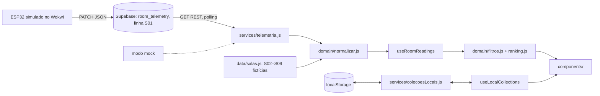

# Arquitetura técnica da aplicação web

Atualizado em 08/11/2026. **Tudo aqui é planejado; nada foi implementado ainda** (ver IMPLEMENTATION_STATUS.md). Baseado no CONTEXTO, §6, §7 e §10.

## 1. O fluxo dos dados



O Supabase **só** guarda a telemetria da S01. Listas, favoritos e login nunca saem do navegador.

## 2. As pastas

```text
GS/                         (raiz do repositório GS-front-web)
├── README.md               começa com a Ficha CitizenTech (edital, p. 21)
├── AI.md                   uso real de IA (p. 41 e 60)
├── CONTEXTO_PROJETO_GS_CITIZENTECH.md
├── docs/                   estes docs
└── web/
    ├── .env.example
    ├── index.html
    └── src/
        ├── main.jsx, App.jsx
        ├── components/     só apresentação; recebem props, não acessam API nem localStorage
        ├── hooks/          estado e efeitos; chamam services/ e domain/
        ├── domain/         funções puras, sem React: ocupação, limiares, classificação, filtros, ranking, normalização
        ├── services/       telemetria.js (Supabase/mock), colecoesLocais.js (localStorage), sessaoDemo.js
        └── data/           salas.js (metadados das 9 e seeds S02–S09)
```

Regra de dependência: `components → hooks → (services, domain) → data`. O `domain/` não importa React, nem `services/`, nem nada com rede ou `localStorage`; o único import de fora dele é o `data/salas.js` (só dados), no `normalizar.js`. É o que os testes cobrem.

## 3. A sala normalizada

Toda sala, venha do Supabase ou do `data/`, vira o mesmo objeto antes de chegar à tela:

```js
{
  id: 'S01',
  nome: 'Sala de Estudo 01',
  porte: 'media',               // 'pequena' | 'media' | 'grande'
  mesas: [1, 2, 0],             // ocupação por mesa, cada uma 0..3
  temperaturaC: 22.8,
  luz: { valor: 410, unidade: 'lux_estimado' },
  ruidoDb: 54,                  // dB SIMULADOS
  origem: 'iot',                // 'iot' (Supabase) | 'mock' (S01 no modo mock: rotular "demonstração") | 'demo' (S02–S09)
  statusDispositivo: 'ok',      // do ESP32: 'ok' | 'sensor_error' | 'offline' (etc.)
                                // da web: 'sem_leitura' (nenhuma linha) | 'dados_invalidos' (algum campo inválido)
                                // null nas salas demo (ou 'dados_invalidos' se o seed estiver errado)
  atualizadoEm: '2026-11-08T14:32:00Z' // null nas salas demo; só data completa (dia, hora e fuso)
}
```

O que não é válido vira `null`, nunca zero: mesa fora de 0..3 ou em quantidade diferente da sala, número fora da faixa do sensor (`LEITURA_POSSIVEL` no `limiares.js`), luz em outra unidade que não `lux_estimado`, data sem hora ou sem fuso. Qualquer status diferente de `'ok'` (e de `null`) leva a sala a `'falha'`.

Os derivados (ocupação total, capacidade, vagas, mesas vazias, taxa, faixas, severidades, estado geral, desatualizado) são **calculados** no `domain/`, nunca guardados (CONTEXTO, §6.3: "a soma é calculada, não enviada"). O desatualizado é o `leituraDesatualizada(atualizadoEm, agora, limiteSegundos)` do `atualizacao.js`; ele não muda o estado geral (RN-11: a última leitura fica, com o aviso), e o limite (`STALE_AFTER_SECONDS`) ainda está pendente.

## 4. Os componentes e os hooks (rubrica: ≥ 8 e ≥ 2)

| Componente | Papel |
|---|---|
| `LoginForm` | matrícula e senha fictícias, erro de preenchimento |
| `DashboardHeader` | nome, sair, atalho para "Minhas listas" |
| `RoomGrid` | a grade dos cards, responsiva |
| `RoomCard` | todas as métricas de uma sala |
| `RoomOccupancy` | as mesas e os lugares, "N mesas totalmente livres" |
| `EnvironmentalMetric` | valor + unidade + faixa + severidade (reusado 3× por card) |
| `DataSourceBadge` | "IoT simulado" / "Dados demonstrativos" |
| `DataFreshnessBadge` | "Atualizado às HH:MM" / "Desatualizado" / "Erro" |
| `FilterPanel` | os intervalos e a mesa livre, "Limpar filtros" |
| `ActivityPresets` | Estudar sozinho / Trabalho em grupo / Gravar vídeo |
| `RoomRanking` | a ordem e o porquê |
| `FavoriteButton` | favoritar/desfavoritar |
| `ListManager` | criar, renomear, excluir, ver listas |
| `ListPicker` | adicionar/remover a sala de uma lista |
| `EmptyState`, `ConfirmDialog` | estado vazio e confirmação de exclusão |

| Hook | Papel |
|---|---|
| `useRoomReadings` | busca a S01, polling, carregando, erro, desatualizado; junta com as 8 demo |
| `useLocalCollections` | o CRUD de listas e favoritos no `localStorage` |
| `useRoomFilters` | o estado dos filtros e do atalho, e o resultado filtrado e ranqueado |
| `useAuthDemo` | o login fictício na sessão |

## 5. A API (Supabase REST)

- Leitura: `GET {VITE_SUPABASE_URL}/rest/v1/room_telemetry?room_id=eq.S01&select=*`, com os cabeçalhos `apikey` e `Authorization: Bearer` da chave **publicável**. Lido com `fetch` puro (o jeito da Aula 14), que mostra o consumo da API às claras. A Aula 18 mostra também o `@supabase/supabase-js`, que não usamos.
- Escrita: só o ESP32 faz `PATCH` na linha S01. O front nunca escreve.
- A tabela proposta está no CONTEXTO, §6.3. `updated_at` de preferência pelo servidor (trigger ou `default now()` no PATCH).
- RLS: leitura pública da tabela; atualização só da linha `S01` e só das colunas de telemetria. A limitação (qualquer um com a chave publicável pode mudar o dado-demo) fica documentada no README (CONTEXTO, §6.4).

## 6. O `localStorage`

Chave `citizentech_user_preferences_v1`, formato do CONTEXTO, §7.7 (`schema_version`, `favorites`, `lists[{id, name, room_ids}]`). O id da lista sai de `crypto.randomUUID()`. JSON ausente ou quebrado volta ao estado vazio sem quebrar a tela (e avisa). Cada navegador/perfil tem o seu; limpar o armazenamento apaga tudo, e o README diz isso.

## 7. As variáveis de ambiente

| Variável | Para quê |
|---|---|
| `VITE_TELEMETRIA_MODO` | `mock` ou `supabase` |
| `VITE_SUPABASE_URL` | a URL do projeto |
| `VITE_SUPABASE_PUBLISHABLE_KEY` | a chave publicável (nunca a `service_role`) |

Tudo que começa com `VITE_` vai para o navegador: por isso só a chave publicável.
